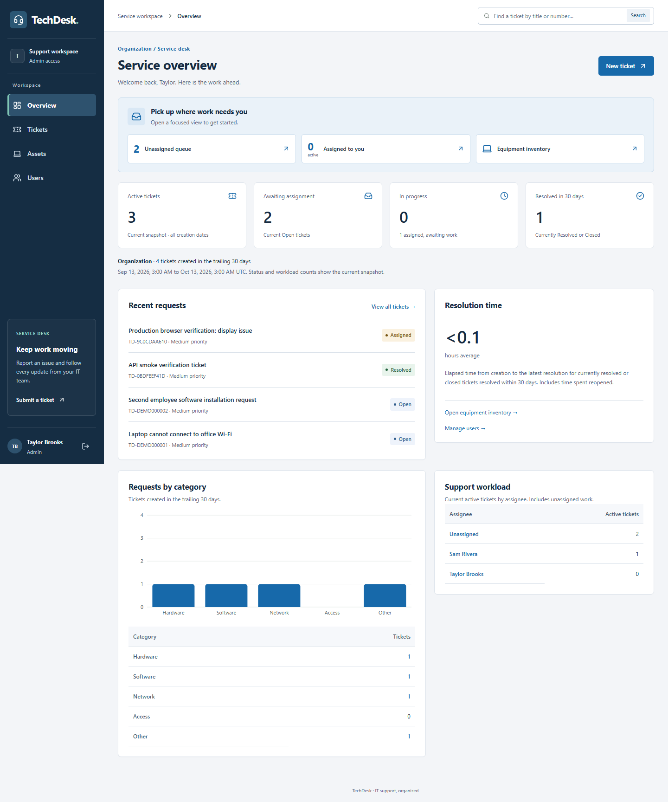

# TechDesk

IT support, organized. A local portfolio web app with simple email/password login, MongoDB persistence, ticket workflows, equipment inventory, user administration, and live reporting.

**Version 1.1.0 local release.** Includes the Salesforce/ServiceNow-inspired enterprise workspace refresh and a second implementation/documentation audit. The user selected a local production package and deployment instructions for phase 08. Publishing, Git commits/pushes, remote Actions and hosted verification remain deferred. See the [current progress and evidence](docs/tracking/progress.md).

All **55/55 revised local-delivery tasks** pass. The source ZIP includes the lockfile and docs; it excludes credentials, dependencies, database files and generated output. Rebuild it with `powershell -NoProfile -ExecutionPolicy Bypass -File scripts/package-release.ps1`; output includes the ZIP and SHA-256 sidecar. [Deployment instructions](docs/operations/deployment-guide.md) cover extraction and private Atlas configuration.

## Working features

- Seeded employee, technician, and administrator accounts; bcrypt password hashes; Auth.js sessions.
- Server-side active-account and current-role checks; employee ticket ownership isolation.
- Ticket submission with category and optional permitted equipment, Open status and Medium priority.
- Search, filters, stable pagination, responsive desktop tables and mobile cards.
- Contextual workspace navigation, global ticket search, role-aware queue shortcuts, predefined list views, and record summaries/current workflow stages.
- Authorized ticket detail, public comments, and filtered activity history.
- Transactional ticket/history and comment/history writes; private seeded diagnostic notes stay hidden from employees.
- Persistent local MongoDB replica set and repeatable, non-destructive fictional seed.
- Technician queue/workload filters; claim, administrator assignment/reassignment/unassignment, priority changes, private notes, and validated start/resolve/close/reopen actions.
- Version conflicts and transactional history; concurrent assignment/deactivation and last-administrator protections.
- Inventory search/filter/pagination; registration, editing, ownership, purchase/warranty fields, lifecycle history, retirement, and linked repair tickets.
- Employee equipment view and linked issue reporting; administrator user provisioning, role changes, and deactivation.
- Role-scoped live dashboard totals, recent tickets, resolution time, category chart with a visible data table, and staff workload.
- Session revocation after role/active-state changes; old sessions stay revoked after reactivation.
- Shared MongoDB mutation quotas, bounded authentication requests, nonce-protected production scripts, and browser security headers.
- Isolated production verification, controlled database preparation, and guarded transactional reset for explicitly disposable demo databases.

## Run locally on Windows

Requirements: Node.js 24 and npm; network access for npm dependencies and the first MongoDB vendor-binary download. Docker and cloud accounts are not required.

From this project folder in PowerShell:

```powershell
npm.cmd ci
npm.cmd run dev
```

Open [localhost:3000](http://localhost:3000). The runner generates a local authentication secret and demo password in ignored .env.local, starts a MongoDB replica set on port 27027, creates indexes, inserts missing fictional seed records, and starts Next.js. Stop with Ctrl+C. Data persists under ignored .local/mongodb across restarts.

| Role | Fictional email |
| --- | --- |
| Employee | employee@techdesk.example |
| Second employee (access checks) | employee2@techdesk.example |
| Technician | technician@techdesk.example |
| Administrator | admin@techdesk.example |

Use DEMO_PASSWORD from your local .env.local for seeded accounts. Seeded users share that initial local demo password. Existing users/passwords are preserved on subsequent seeds; changing DEMO_PASSWORD does not change their stored password hashes. Do not discard .env.local if you want to keep the local credentials/session secret.

These are fictional local accounts, not public production accounts. No public signup or password recovery is implemented.

For a production preview on the managed local database, stop dev, run `npm.cmd run build`, then `npm.cmd run preview`. Existing records and credentials are preserved. The local runner refuses to override an externally configured MONGODB_URI.

## External MongoDB

Use a transaction-capable replica set or Atlas database; a standalone MongoDB instance is insufficient. Configure MONGODB_URI, AUTH_SECRET, and AUTH_URL privately in .env.local. The supplied cluster template is in [.env.atlas.example](.env.atlas.example); replace its credentials and use the explicit /techdesk database. [Connection and deployment instructions](docs/operations/deployment-guide.md) explain setup, network access, and optional seed. No Atlas connection with real credentials was provided or tested in this delivery.

```powershell
npm.cmd run db:prepare
# Only for an empty, intentionally fictional techdesk demo:
npm.cmd run db:seed
npm.cmd run dev:external
```

Seed requires DEMO_PASSWORD and refuses database names other than techdesk/techdesk_test. It inserts only missing fictional records and never resets existing data. External database setup and production deployment are not performed by this project deliverable.

## Verification

```powershell
npm.cmd run lint
npm.cmd run typecheck
npm.cmd test
npm.cmd run build
# Isolated production HTTP checks; no persistent records changed:
npm.cmd run test:release
# One-time browser download for the full browser/CI checks:
npm.cmd run browser:install
# Production browser workflow with its own temporary database:
npm.cmd run test:browser
# All CI-equivalent checks, including route type generation and production HTTP:
npm.cmd run verify
# Optional: with a local fictional app running; adds named smoke records:
npm.cmd run test:smoke
```

57 unit/integration tests cover ownership, roles, private projections, strict inputs/password byte limits, streamed requests, workflow/concurrency/rollback, inventory, deactivation, last-admin protection, pagination, deterministic reports, encrypted-token expiry/tampering, session revocation, concurrent rate limits, guarded reset/rollback, coherent asset detail reads, and managed database boundaries. Integration tests use isolated real MongoDB replica sets. test:release starts the production build on port 3100 with random temporary credentials/database and exercises all roles, nonce headers, ownership, ticket/inventory/admin APIs and session revocation. test:browser adds a repeatable Chromium employee/technician/admin workflow, workspace search/list views, assignee filter preservation, private-note checks, mobile overflow, keyboard focus and sign-out. Both preserve .env.local and persistent records; verify includes the browser run.

test:smoke by itself adds named fictional tickets, retired equipment and an inactive verification account to the configured loopback demo; do not run it against real employee data. It refuses non-loopback destinations. Normal sign-in is limited to ten attempts per normalized email per ten-minute window; writes are limited to 60 per minute/1,000 per UTC day per account. Rate-limit errors return 429 and Retry-After. These shared-account demo limits are separate from host-level anonymous traffic controls.

Build/lint/typecheck and desktop/mobile browser verification are recorded in the phase evidence. CI is prepared in .github/workflows/ci.yml; it has not run on a remote repository. [Source review](docs/quality/source-review.md) records findings and fixes. [Dependency audit](docs/quality/dependency-audit.md) records an open development-only lint advisory; the runtime-only audit returned zero vulnerabilities.

The external production start command needs an independently running MongoDB replica set and configured environment; preview manages the local database. [Backup/recovery](docs/operations/backup-and-recovery.md) and [controlled demo reset](docs/operations/deployment-guide.md#controlled-resettable-demo) are documented. Reset never accepts the ordinary techdesk database.

## Screenshots



[Desktop request list](docs/design/screenshots/release-tickets-desktop.png) ? [Mobile request cards](docs/design/screenshots/release-tickets-mobile.png) ? [Mobile record](docs/design/screenshots/release-workflow-mobile.png)

[Record workspace](docs/design/screenshots/release-record-desktop.png) ? [Mobile equipment](docs/design/screenshots/release-equipment-mobile.png) ? [Mobile users](docs/design/screenshots/release-users-mobile.png)

See the [design references](docs/design/enterprise-workspace.md), [current audit](docs/quality/enterprise-refresh-review.md), and [upgrade ideas](docs/tracking/follow-ups.md). Earlier JPG screenshots are historical phase evidence.

## Stack and architecture

Next.js 16.4, React 19.3, TypeScript 6, Tailwind CSS 4, Mongoose 9, MongoDB, Auth.js 5 beta, bcryptjs, Zod, Recharts 3.10, and Vitest. Versions are pinned in package.json/lockfile; review the Auth.js beta before production release.

Pages/API → authenticated server services → Mongoose → MongoDB. Password hashes/staff notes are never included in employee response projections. UTC timestamps are displayed in labeled Eastern time for this initial UI.

Mutation coordination and limits are documented in [decision 002](docs/decisions/002-workflow-inventory-and-reports.md). The small-app transaction guard serializes writes to preserve cross-record invariants. Selectors currently show up to 100 equipment options/500 active users; full inventory/user lists have pagination. Reporting windows are labeled in UTC. New account passwords require at least 12 characters and at most 72 UTF-8 bytes. Deactivation requires reassigning active tickets and equipment first.

## M1 walkthrough

1. Sign in as the employee, open My equipment, select a laptop, and Report an issue. Submit its title/category/description.
2. Sign out, sign in as the technician, open the ticket, and Claim ticket. Start work, add a private diagnostic note, change priority if needed, and resolve with a public summary. Close the ticket.
3. Return as the employee. Confirm the public resolution/activity and that private notes are absent. Reopen with a reason; the ticket returns to Assigned when the staff assignee remains eligible.
4. As administrator, use assignment controls, register/edit equipment, manage users, and inspect the organization dashboard. Employees see their own records; technicians see the queue and their workload.

- [Phase plans and specifications](docs/README.md)
- [Progress and evidence](docs/tracking/progress.md)
- [Implementation decisions](docs/decisions/001-initial-implementation.md)
- [Local release and security decisions](docs/decisions/003-local-release-and-security.md)
- [Deployment instructions](docs/operations/deployment-guide.md)
- [Interview walkthrough](docs/operations/interview-walkthrough.md)
- [Follow-up backlog](docs/tracking/follow-ups.md)
- [Skills/plugin guide](skills.md)

MIT licensed; see LICENSE.
